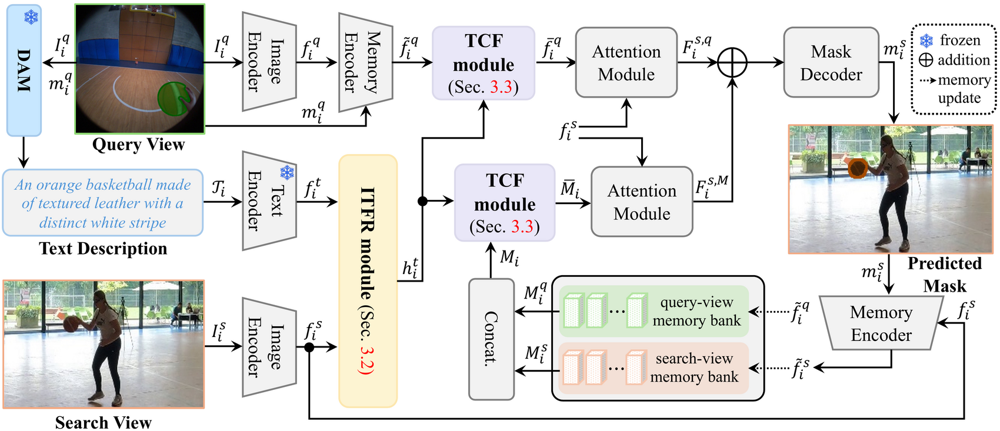
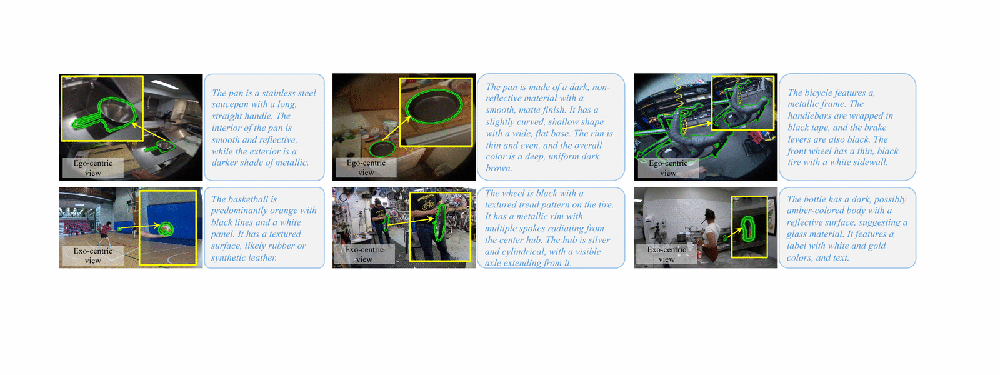
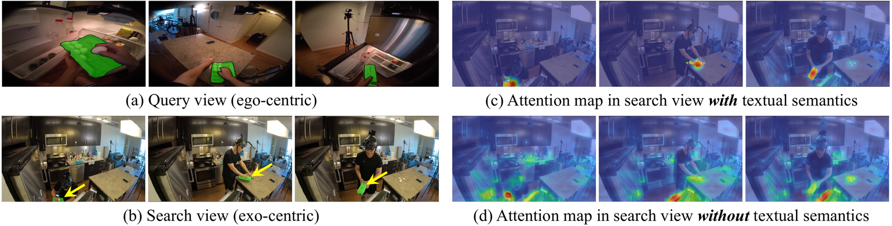
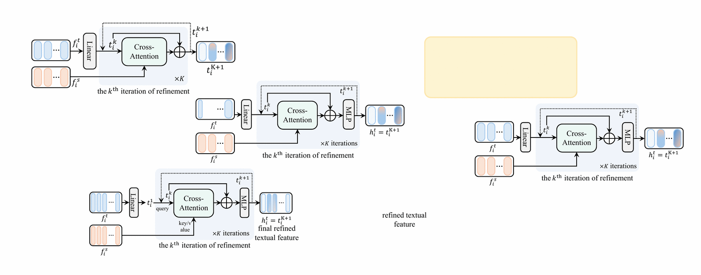
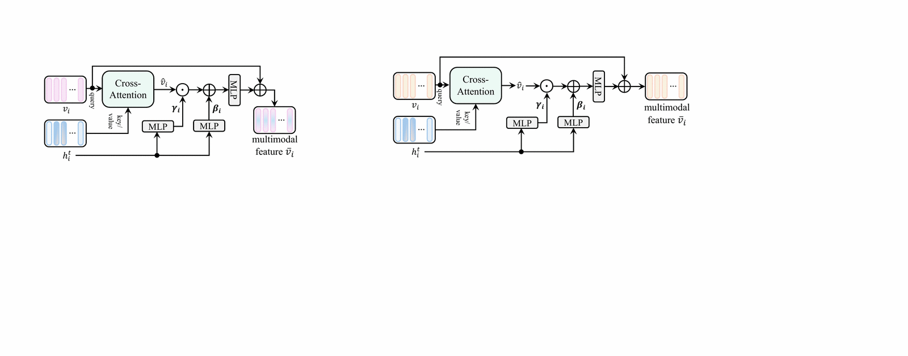
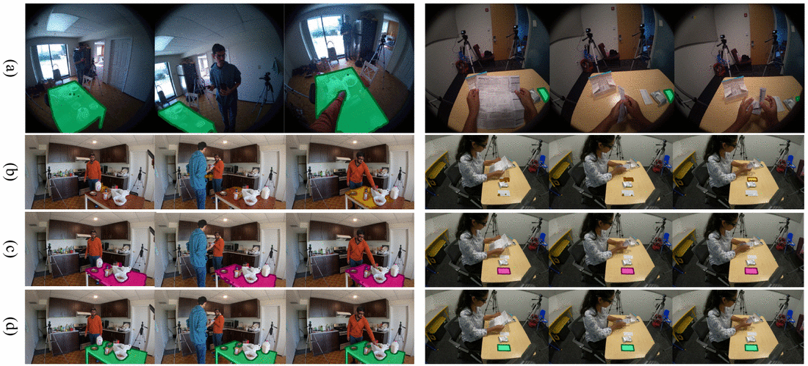
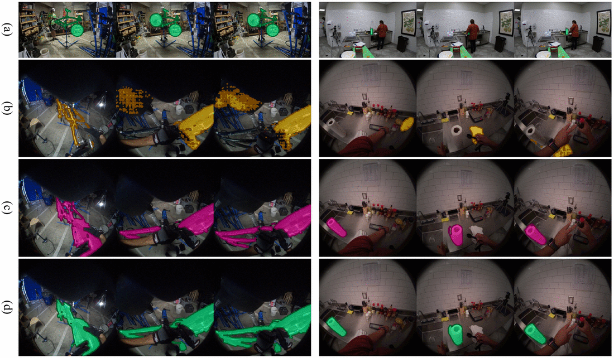

# TeSCo

**Exploiting Textual Semantics for Robust Cross-View Object Correspondence** — NeurIPS 2026

Given an object marked in one camera's video, segment the same object in another camera's video
of the same scene. TeSCo describes the object in words first, then uses that description to find
it in the other view — which survives the viewpoint and appearance changes that defeat purely
visual matching.

<p align="center"></p>

The query view's object is captioned by a vision-language model. **ITFR** refines that text against
the search view, and **TCF** fuses the refined text into the visual features that SAM 2's decoder
sees. Everything else is SAM 2.1.

## Results

Ego-Exo4D correspondence test split:

| Method | Ego→Exo IoU | Exo→Ego IoU | mIoU |
|---|---|---|---|
| ObjectRelator [ICCV'25] | 35.30 | 40.30 | 37.80 |
| O-MaMa [ICCV'25] | 42.60 | 44.10 | 43.35 |
| V²-SAM [CVPR'26] | 46.30 | 49.60 | 47.95 |
| LM-EEC [NeurIPS'25] | 54.98 | 65.77 | 60.38 |
| Baseline (ours, no text) | 52.70 | 58.30 | 55.50 |
| **TeSCo** | **60.40** | **70.30** | **65.35** |

Text is worth **9.85 mIoU** over the same model without it.

> **Comparing against us?** Published numbers on this benchmark come from more than one scorer,
> and they differ by over an IoU point on identical predictions. The paper follows the official
> Ego-Exo4D metrics; our predictions cover the test split, so the prediction-driven variant this
> codebase also ships agrees to 0.21 IoU (70.69 vs 70.48 on Exo→Ego). Other rows in the table are
> not all on that protocol — O-MaMa's published figure is on its own scorer.
> [`docs/METRIC_SETTINGS.md`](docs/METRIC_SETTINGS.md) gives our results under each and says
> exactly what differs.

## What the text actually is

<p align="center"></p>

A vision-language model (DAM) describes the marked object in the query view — category, colour,
texture, material. These attributes hold across viewpoints in a way raw pixels do not, which is
the whole premise. The paper refreshes the description **every frame**; refreshing less often is
cheaper and measurably worse (60.40 at every frame, 59.10 every 5, 59.00 every 10). Captions are
precomputed per frame with `tools/precompute_dam_frame_captions.py` and read from
`text_labels/`, so inference does not call the VLM.

## Why text helps

<p align="center"></p>

Attention in the search view, with textual semantics (c) and without (d). The text pulls
attention onto the target instead of spreading it over visually similar regions.

## The two modules

| ITFR — iterative textual feature refinement | TCF — text-conditioned cross-modal fusion |
|---|---|
|  |  |
| Not every word in a caption applies to the current search-view frame. ITFR adjusts the text feature against that frame before fusion, for `K=2` iterations. | Injects the refined text into visual features by text-guided modulation, producing the multimodal target representation the mask decoder consumes. |

[`docs/ARCHITECTURE.md`](docs/ARCHITECTURE.md) maps each of these to the code, file by file.

## Qualitative results

| Ego→Exo | Exo→Ego |
|---|---|
|  |  |

Left to right in each: query view, baseline, TeSCo, search view with ground truth.

## Quick start

```bash
conda env create -f environment.yml && conda activate tesco
pip install -e .
```

Obtain Ego-Exo4D and place it under `data/` — [`docs/SETUP.md`](docs/SETUP.md) gives the exact
layout. Then:

```bash
# 1. predict  (Ego->Exo; add --exo_to_ego for the other direction)
python tools/correspondence_inference.py \
  --sam2_cfg sam2.1/sam2.1_hiera_b+_egoexo_text.yaml \
  --sam2_checkpoint training/checkpoints_EgoExo/tesco_egoexo4d_epoch59_for_inference.pt \
  --base_video_dir data/EgoExo4D/data_segswap_test \
  --input_mask_dir data/EgoExo4D/data_segswap_test \
  --output_mask_dir output/ego2exo \
  --caption_subdir dam_frame_captions_v2

# 2. assemble per-take PNGs into one submission JSON
python evaluation/merge_pred.py --input output/ego2exo --pred output/ego2exo \
  --gt data/gt_results/relations_test_from_annotationjson.json
python evaluation/merge_results.py --input_dir data/EgoExo4D --split data_segswap_test \
  --pred_dir output/ego2exo --json_path output/ego2exo.json

# 3. score
python evaluation/unified_eval.py --gt data/gt_results/egoexo_test_gt.json \
  --pred output/ego2exo.json --task ego-exo --coverage both
```

Training and every flag: [`docs/SETUP.md`](docs/SETUP.md).

## Three scorers, and why

Published results on this benchmark are not all on the same protocol, so all three are here:

| | protocol | what it does |
|---|---|---|
| `evaluation/compute_metrics.py` | **LM-EEC** — this codebase's inherited scorer | walks the prediction file; a row you did not predict is omitted |
| `evaluation/omama_eval.py` | **O-MaMa** | walks the GT, filters by `annotated_frames`, resizes the GT onto your prediction's grid |
| `evaluation/unified_eval.py` | **official benchmark** — use this to compare methods | walks the GT, scores a missing prediction as 0, puts both sides on a 480×480 grid |

On identical predictions our Exo→Ego scores **74.16** under LM-EEC's and **72.92** under
O-MaMa's. Only IoU moves; contour accuracy and location error agree to three decimals.
[`docs/METRIC_SETTINGS.md`](docs/METRIC_SETTINGS.md) has the measurements and the cause.

## What is and isn't reproducible here

Stated plainly, because a results table that hides this is worth less than one that does not:

- **Exo→Ego reproduces.** `tesco_egoexo4d_epoch59_for_inference.pt` is bit-identical to the
  checkpoint behind the published number and scores 70.48.
- **Ego→Exo does not.** Neither bundled checkpoint is the one behind the published 60.40 — they
  belong to a different model variant this code cannot load.
  [`docs/REPRODUCE.md`](docs/REPRODUCE.md) §2 shows the state-dict diff.
- **`dam_frame_captions_v2_exo` covers 201 of 291 test takes.** A take with no captions does not
  raise; it silently produces a confounded prediction. Check with
  `python tools/check_captions.py` before any long run.

## Documentation

| | |
|---|---|
| [`docs/METRIC_SETTINGS.md`](docs/METRIC_SETTINGS.md) | the two metric protocols, our results under both, which the paper reports |
| [`docs/RESULTS.md`](docs/RESULTS.md) | Table 1 row by row — which rows we re-measured and which we cite |
| [`docs/REPRODUCE.md`](docs/REPRODUCE.md) | exact commands, checkpoint ↔ direction, protocol-sensitivity ablations |
| [`docs/SETUP.md`](docs/SETUP.md) | environment, datasets, text labels, checkpoints, training, all flags |
| [`docs/ARCHITECTURE.md`](docs/ARCHITECTURE.md) | architecture ↔ code, file by file |
| [`docs/ANNOTATION_FORMATS.md`](docs/ANNOTATION_FORMATS.md) | `annotation.json` and GT JSON schemas |
| [`docs/RELEASE_CHECKLIST.md`](docs/RELEASE_CHECKLIST.md) | what to settle before publishing this repo |

Verification helpers, each of which reproduces a figure quoted in the docs:
`tools/check_gt.py`, `tools/check_captions.py`, `tools/diff_checkpoints.py`,
`tools/make_selftest_pred.py`.

## Known limitations

- No checkpoint is included for a text-ablated baseline. The code handles `text_feat is None`
  by skipping ITFR/TCF, but that path is not validated as an ablation baseline.
- This repository consolidates an iterative research codebase into one tree — treat it as a
  reference implementation and spot-check before building on it.

## Citation

```bibtex
@inproceedings{tesco2026,
  title     = {Exploiting Textual Semantics for Robust Cross-View Object Correspondence},
  booktitle = {Advances in Neural Information Processing Systems (NeurIPS)},
  year      = {2026}
}
```

Please also cite the correspondence backbone this builds on, and SAM 2:

```bibtex
@article{hu2025robust,
  title   = {Robust Ego-Exo Correspondence with Long-Term Memory},
  author  = {Hu, Yijun and Fan, Bing and Gu, Xin and Ren, Haiqing and Liu, Dongfang
             and Fan, Heng and Zhang, Libo},
  journal = {arXiv preprint arXiv:2510.11417},
  year    = {2025}
}
```
